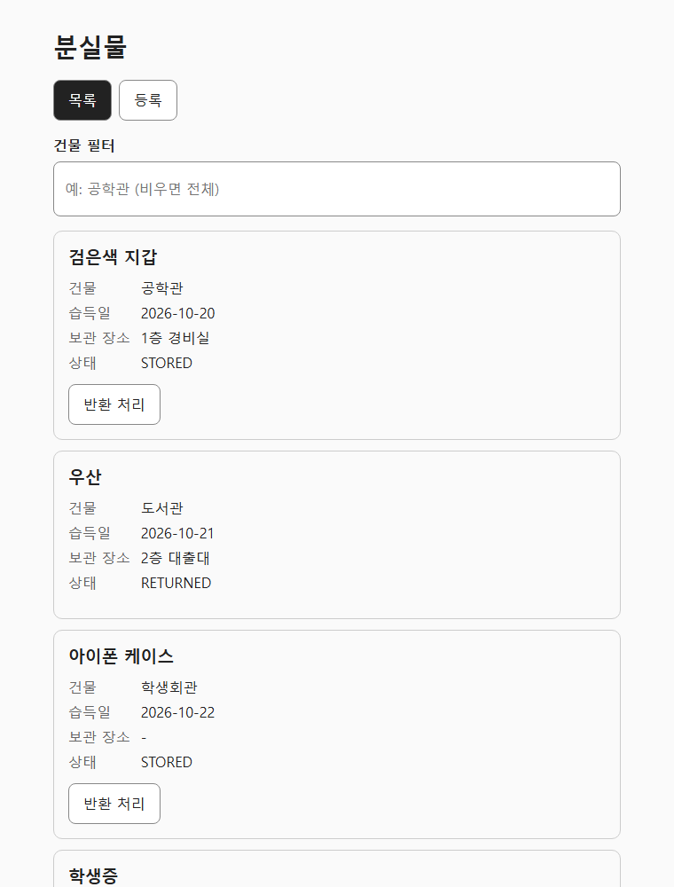

# SpringBoot-test (Lost Items API)

[](https://github.com/Youkwangchae/SpringBoot-test/actions/workflows/ci.yml)

분실물 등록·조회·반환 처리를 하는 REST API(Spring Boot)와 React 화면(web/)입니다.



## 배경

학교 때 Firebase로 만든 분실물 앱의 백엔드를 Spring Boot와 JPA로 옮겨 본 프로젝트입니다. 면접을 준비하면서 공고에 나온 기술을 직접 써 보려고 시작했습니다.

## 무엇을 왜 옮겼나

- **Firebase(NoSQL) → Spring Boot + JPA + H2(RDB)**: 스키마를 먼저 정하고, 상태 변경 같은 규칙은 서비스 계층과 제약으로 지키게 했습니다.
- **기존 앱의 동작을 테스트로 먼저 정의**: 등록 후 목록 노출, 건물 필터, 반환 처리, 없는 id 404, 이미 반환된 물건 409를 테스트로 고정한 뒤 구현했습니다.
- **GitHub Actions CI**: push와 PR마다 백엔드 테스트와 프론트 빌드·테스트를 자동으로 돌립니다.

## 구성

| 경로 | 내용 |
|---|---|
| `src/` | Spring Boot API (controller → service → repository, DTO로만 응답) |
| `web/` | React + TypeScript + Vite 화면 (목록·건물 필터·반환, 등록 폼) |
| `CLAUDE.md` | AI 코딩 도구에 준 규칙 (계층, 상태 코드, 테스트 먼저) |
| `NOTES.md` | AI가 만든 코드에서 직접 고친 부분 기록 |

### API

| 메서드 | 경로 | 설명 |
|---|---|---|
| POST | `/items` | 등록 (이름·건물 필수, 실패 시 400) |
| GET | `/items?building=공학관` | 목록 (건물 필터 선택) |
| GET | `/items/{id}` | 상세 (없으면 404) |
| PATCH | `/items/{id}/return` | 반환 처리 (이미 반환됐으면 409) |

## 실행 방법

필요한 것: JDK 21, Node.js LTS. Windows 기준입니다. macOS/Linux는 `gradlew.bat` 대신 `./gradlew`를 씁니다.

### 1. 백엔드 (포트 8080)

```bat
gradlew.bat test
gradlew.bat bootRun
```

`JAVA_HOME`이 JDK 21을 가리켜야 합니다. 데이터는 H2 메모리 DB에 저장되므로 서버를 끄면 초기화됩니다.

### 2. 프론트 (포트 5173)

백엔드가 떠 있는 상태에서 다른 터미널을 열고 실행합니다.

```bat
cd web
npm ci
npm run dev
```

브라우저에서 http://localhost:5173 을 열면 됩니다. 개발 서버가 `/items` 요청을 백엔드(8080)로 넘기므로 CORS 설정은 필요 없습니다.

### 3. 프론트 테스트와 빌드

```bat
cd web
npm test
npm run build
```
